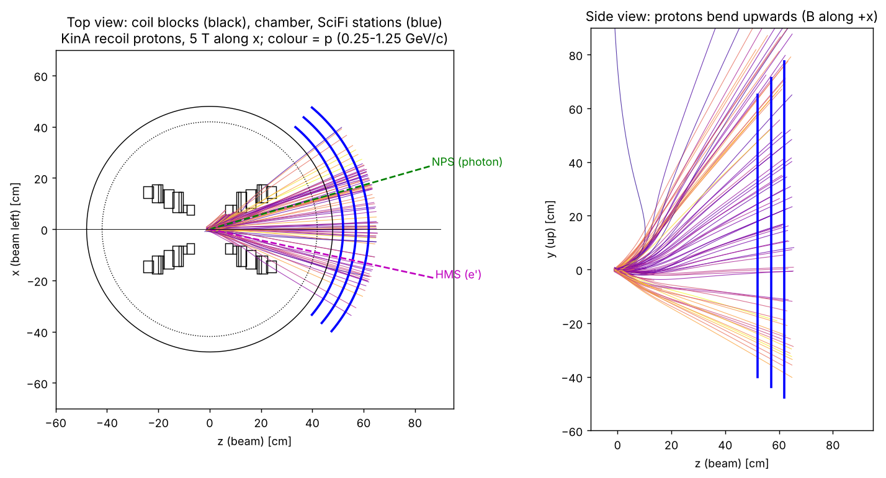
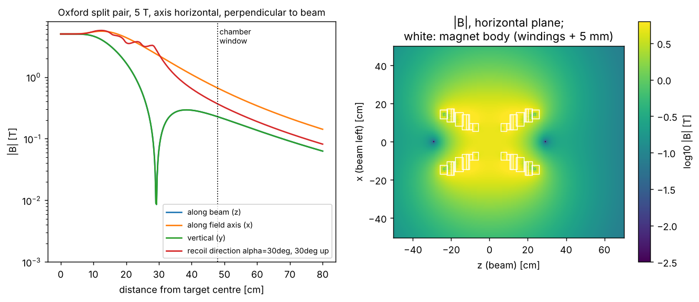
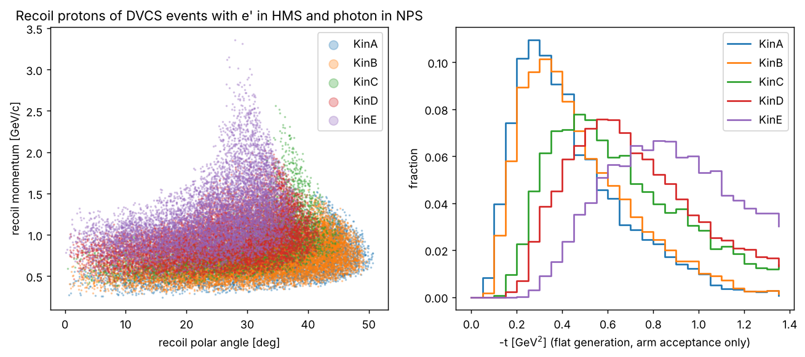
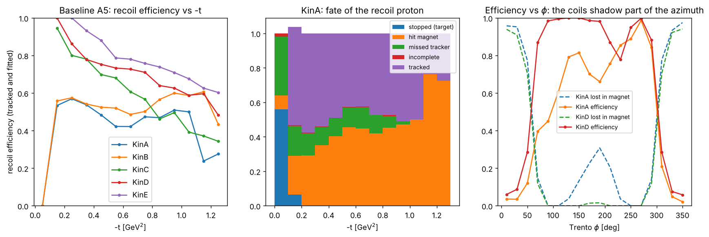
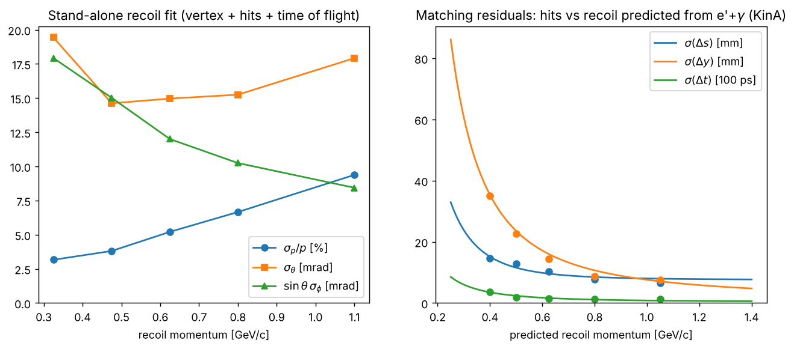
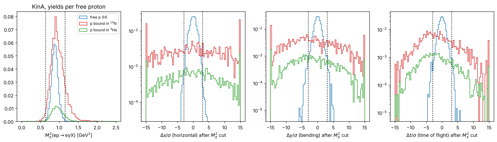
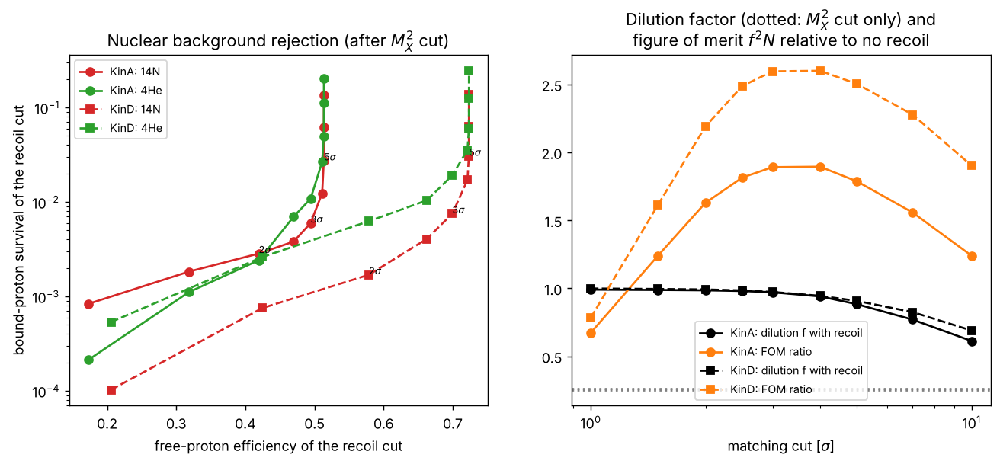

# Recoil SciFi detector: simulation results

Generated by `scripts/make_report.py` from the runs of `scripts/run_study.py`. Numbers are weighted with exp(2.5 t) and are per DVCS event with the electron in the HMS and the photon on the NPS face. See `docs/recoil_scifi_design.md` for the method and the assumptions.

## Kinematic settings

| setting | E [GeV] | x_B | Q^2 [GeV^2] | E' [GeV] | theta_e (HMS) | theta_q (NPS) |
|---|---|---|---|---|---|---|
| KinA | 10.6 | 0.36 | 3.0 | 6.16 | 12.3 deg | 16.0 deg |
| KinB | 10.6 | 0.36 | 4.0 | 4.68 | 16.3 deg | 12.1 deg |
| KinC | 10.6 | 0.5 | 3.4 | 6.98 | 12.3 deg | 21.5 deg |
| KinD | 10.6 | 0.5 | 4.8 | 5.48 | 16.5 deg | 16.3 deg |
| KinE | 10.6 | 0.6 | 5.1 | 6.07 | 16.2 deg | 19.5 deg |

## Baseline (A5): fate of the recoil proton and stand-alone resolution

| setting | stopped | hit magnet | missed tracker | incomplete | tracked | fitted | sigma_p/p | sigma_theta [mrad] | sin(theta) sigma_phi [mrad] | sigma_t/t (recoil only) |
|---|---|---|---|---|---|---|---|---|---|---|
| KinA | 0.024 | 0.324 | 0.130 | 0.004 | 0.525 | 0.514 | 0.057 | 18.0 | 10.9 | 0.104 |
| KinB | 0.012 | 0.319 | 0.117 | 0.005 | 0.554 | 0.543 | 0.061 | 18.3 | 9.9 | 0.110 |
| KinC | 0.000 | 0.262 | 0.038 | 0.004 | 0.696 | 0.692 | 0.068 | 16.2 | 10.5 | 0.118 |
| KinD | 0.000 | 0.233 | 0.026 | 0.004 | 0.737 | 0.735 | 0.075 | 15.7 | 11.0 | 0.128 |
| KinE | 0.000 | 0.197 | 0.031 | 0.003 | 0.769 | 0.767 | 0.088 | 13.3 | 11.9 | 0.146 |

## Baseline (A5): exclusivity with the recoil (3 sigma matching cut)

Efficiencies are relative to the M_X^2 cut [0.63, 1.15] GeV^2. f = dilution factor (free-proton share of the selected DVCS yield); FOM = f^2 N relative to the M_X^2 cut alone (> 1: the recoil improves the statistical precision of target asymmetries). Neutron/proton yield ratio 0.3.

| setting | matching sigma_s / sigma_y at 0.5 GeV/c [mm] | sigma_tof [ns] | free eff. | 14N survival | 4He survival | f (M_X^2 only) | f (with recoil) | FOM ratio |
|---|---|---|---|---|---|---|---|---|
| KinA | 11.6 / 23.6 | 0.24 | 0.494 | 0.006 | 0.011 | 0.254 | 0.971 | 1.89 |
| KinB | 9.9 / 21.0 | 0.23 | 0.517 | 0.004 | 0.009 | 0.258 | 0.982 | 1.97 |
| KinC | 14.8 / 22.4 | 0.21 | 0.657 | 0.013 | 0.021 | 0.260 | 0.955 | 2.41 |
| KinD | 11.9 / 19.2 | 0.18 | 0.699 | 0.008 | 0.019 | 0.262 | 0.973 | 2.60 |
| KinE | 11.2 / 22.0 | 0.16 | 0.737 | 0.011 | 0.020 | 0.267 | 0.966 | 2.66 |

## Scenario comparison (KinA and KinD)

| scenario | description | setting | hit magnet | tracked | sigma_p/p | free eff. | 14N survival | f (with recoil) | FOM ratio | channels | x/X0 |
|---|---|---|---|---|---|---|---|---|---|---|---|
| A5 | baseline: 3 stations at R=52/57/62 cm outside the chamber, 1 mm fibres, 5 T | KinA | 0.324 | 0.525 | 0.057 | 0.494 | 0.006 | 0.971 | 1.89 | 17973 | 4.19% |
| A5 | baseline: 3 stations at R=52/57/62 cm outside the chamber, 1 mm fibres, 5 T | KinD | 0.233 | 0.737 | 0.075 | 0.699 | 0.008 | 0.973 | 2.60 | 17973 | 4.19% |
| A5_2st | 2 stations (R=52, 62 cm) | KinA | 0.323 | 0.534 | 0.061 | 0.495 | 0.009 | 0.960 | 1.85 | 11982 | 2.79% |
| A5_2st | 2 stations (R=52, 62 cm) | KinD | 0.232 | 0.737 | 0.081 | 0.698 | 0.008 | 0.972 | 2.59 | 11982 | 2.79% |
| A5_d2 | 2 mm fibres | KinA | 0.322 | 0.504 | 0.058 | 0.471 | 0.005 | 0.974 | 1.80 | 8986 | 7.74% |
| A5_d2 | 2 mm fibres | KinD | 0.233 | 0.735 | 0.084 | 0.695 | 0.006 | 0.979 | 2.61 | 8986 | 7.74% |
| A25 | 2.5 T field | KinA | 0.321 | 0.629 | 0.058 | 0.587 | 0.004 | 0.982 | 2.31 | 17973 | 4.19% |
| A25 | 2.5 T field | KinD | 0.232 | 0.739 | 0.090 | 0.700 | 0.006 | 0.981 | 2.61 | 17973 | 4.19% |
| B5 | 3 stations in vacuum at R=30/34/38 cm | KinA | 0.315 | 0.534 | 0.056 | 0.492 | 0.007 | 0.966 | 1.89 | 10761 | 4.19% |
| B5 | 3 stations in vacuum at R=30/34/38 cm | KinD | 0.234 | 0.730 | 0.054 | 0.691 | 0.011 | 0.963 | 2.54 | 10761 | 4.19% |
| A5_m0 | magnet body = bare windings (optimistic) | KinA | 0.279 | 0.557 | 0.056 | 0.516 | 0.006 | 0.970 | 1.96 | 17973 | 4.19% |
| A5_m0 | magnet body = bare windings (optimistic) | KinD | 0.183 | 0.788 | 0.078 | 0.747 | 0.009 | 0.974 | 2.77 | 17973 | 4.19% |
| A5_m10 | magnet body = windings + 10 mm (pessimistic) | KinA | 0.384 | 0.467 | 0.054 | 0.438 | 0.005 | 0.970 | 1.67 | 17973 | 4.19% |
| A5_m10 | magnet body = windings + 10 mm (pessimistic) | KinD | 0.292 | 0.681 | 0.073 | 0.645 | 0.008 | 0.971 | 2.43 | 17973 | 4.19% |
| A5_vert | field axis vertical (different magnet) | KinA | 0.341 | 0.507 | 0.055 | 0.481 | 0.003 | 0.983 | 1.86 | 17973 | 4.19% |
| A5_vert | field axis vertical (different magnet) | KinD | 0.123 | 0.835 | 0.083 | 0.803 | 0.008 | 0.978 | 3.03 | 17973 | 4.19% |
| A5_tall | taller tracker: y from -60 to +100 cm at R=52 cm | KinA | 0.315 | 0.618 | 0.054 | 0.567 | 0.009 | 0.963 | 2.10 | 22041 | 4.19% |
| A5_tall | taller tracker: y from -60 to +100 cm at R=52 cm | KinD | 0.226 | 0.747 | 0.075 | 0.712 | 0.008 | 0.975 | 2.66 | 22041 | 4.19% |

## Figures

**Geometry and sample recoil tracks**

**Target magnet field**

**Recoil kinematics**

**Recoil efficiency vs -t and phi**

**Resolutions**

**Exclusivity variables, free vs bound protons**

**Nuclear background rejection and dilution**

